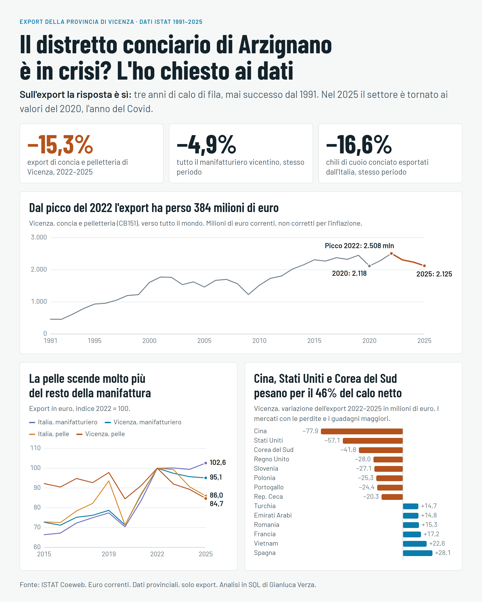

# Il distretto conciario di Arzignano è in crisi? L'ho chiesto ai dati

Analisi in SQL (MySQL) di 35 anni di export della provincia di Vicenza, dati ISTAT 1991–2025.



## La risposta in breve

**Sull'export, sì.** Dal 2023 al 2025 l'export di concia e pelletteria di Vicenza è sceso per tre anni di fila, cosa mai successa dal 1991. Nel 2025 è tornato ai valori del 2020, l'anno del Covid, in euro correnti.

| Export, 2022–2025 | Variazione |
|---|---|
| Vicenza, concia e pelletteria | **−15,3%** (da 2.508 a 2.125 milioni di euro) |
| Vicenza, tutto il manifatturiero | −4,9% |
| Italia, concia e pelletteria | −14,0% |
| Italia, tutto il manifatturiero | +2,6% |

## Cosa ho trovato

**1. Il calo riguarda la pelle.** La manifattura italiana cresce, quella vicentina cala molto meno della pelle. Il peso del settore sull'export manifatturiero vicentino passa dal 15,1% del 2001 al 9,6% del 2025.

**2. Si vende meno cuoio, e il prezzo medio tiene.** A livello nazionale, tra il 2022 e il 2025 il valore dell'export di cuoio conciato scende del 14,2% e i chili del 16,6%, mentre il prezzo medio sale da 12,28 a 12,64 €/kg. Il prezzo medio però può ingannare, perché va da circa 2,50 €/kg in Cina a oltre 50 €/kg in Francia. Per questo ho rifatto la scomposizione paese per paese:

| Scomposizione della variazione di valore | Milioni di euro |
|---|---|
| Effetto dei volumi | −486,6 |
| Effetto dei prezzi | +37,1 |
| Paesi senza confronto completo | +1,1 |
| **Totale** | **−448,3** |

Il risultato regge, ma va letto con cautela: i prezzi salgono in 52 mercati e scendono in 58. La Cina da sola vale il 50% dei chili persi, ma pesa molto meno sul valore. Nel 2025 l'Italia ha esportato circa 214.500 tonnellate, il minimo dal 1995 e il 46% in meno del picco del 2006.

**3. Pochi mercati pesano molto.** Su un calo netto di 383 milioni di euro, Cina (−78), Stati Uniti (−57) e Corea del Sud (−42) valgono il 46%. Spagna, Vietnam e Francia crescono, ma i guadagni complessivi (149 milioni) non compensano le perdite (532 milioni).

**4. La trappola della quota.** La quota di Vicenza sull'export italiano scende dal 31,2% del 2002 al 17,7% del 2025, e sembra un crollo del distretto. In quegli anni però la concia passa dal 70% al 23% del settore nazionale, perché è esplosa la pelletteria. Dal 2022 la quota è quasi ferma (18,0% → 17,7%): il calo recente riguarda tutta Italia.

## Limiti dell'analisi

- **Solo export.** Non ci sono dati su produzione, occupazione, vendite in Italia o margini. I dati mostrano che cosa è cambiato, non il perché.
- **Province, non comuni.** Vicenza approssima il distretto della Valle del Chiampo, ma non coincide con esso.
- **Concia e pelletteria insieme.** Per le province ISTAT pubblica solo il codice CB151, senza dettaglio tra CB1511 e CB1512.
- **Chili solo nazionali.** Per le province ISTAT non li pubblica. L'analisi valore-chili riguarda l'Italia e la sola concia, come approssimazione dichiarata del distretto.
- **Euro correnti.** I valori non sono corretti per l'inflazione, quindi in termini reali il calo sarebbe più ampio.
- **Prezzo al kg.** Dipende anche dal mix di prodotto, non solo dal listino.
- **Dati recenti.** ISTAT può rivedere gli ultimi anni.

## Come è fatto il database

```
staging_export   CSV caricati così come sono, senza vincoli
      |
      v
territori   prodotti (con gerarchia CB1511 -> CB151 -> C)   partner (paese / aggregato / altro)
      \          |          /
       v         v         v
                export       tabella dei fatti, chiave primaria su 5 colonne
```

Tre problemi dei dati e come li ho gestiti:

- **Aggregati mescolati ai paesi.** `PARTNER_COUNTRY` contiene sia paesi sia voci come `WORLD`, `EU27_2020` e `ASI`: sommandoli tutti si conterebbe lo stesso export più volte. Ogni codice è classificato come paese, aggregato o altro. Controllo: paesi e altro differiscono dal totale `WORLD` al massimo dello 0,11%.
- **Righe doppie.** 70 righe compaiono in due CSV con valori identici: la staging ne ha 17.456, `export` 17.386.
- **Paesi con due codici.** Grecia (`EL`, poi `GR`) e Montenegro (`XM`, poi `ME`) sono unificati, così le serie storiche non si spezzano.

Tecniche SQL usate: CTE, funzioni finestra (`LAG`, `RANK`, `SUM() OVER`, `MAX() OVER`), aggregazione condizionale con `CASE`, chiavi primarie ed esterne, vincoli `CHECK`, `LOAD DATA`.

## I file

| Percorso | Contenuto |
|---|---|
| [`sql/01`–`06`](sql/) | Creazione del database, caricamento, schema, pulizia e controlli |
| [`sql/07_trend.sql`](sql/07_trend.sql) | Andamento, confronti con base 2022, quote |
| [`sql/08_valore_chili.sql`](sql/08_valore_chili.sql) | Valore, chili, prezzo e scomposizione |
| [`sql/09_paesi.sql`](sql/09_paesi.sql) | Contributo di ogni mercato al calo |
| [`results/`](results/) | Risultati principali in CSV |
| [`dashboard/`](dashboard/) | Dashboard interattiva e immagine di sintesi |
| [`data/`](data/) | CSV originali ISTAT |

## Come riprodurre l'analisi

Serve MySQL 8. Copia i tre CSV di `data/` nella cartella indicata da `SHOW VARIABLES LIKE 'secure_file_priv'`; se è diversa da quella di default su Windows, aggiorna i percorsi in `sql/03_load_staging.sql`. Poi, dalla cartella del progetto:

```
mysql -u root -p --default-character-set=utf8mb4 -e "source sql/run_all.sql"
```

## Fonte e strumenti

Dati: [ISTAT Coeweb](https://esploradati.istat.it/coeweb/databrowser), tavola "CPAteco 2007 dato annuale a livello provinciale - dal 1991".

Progetto di Gianluca Verza.
